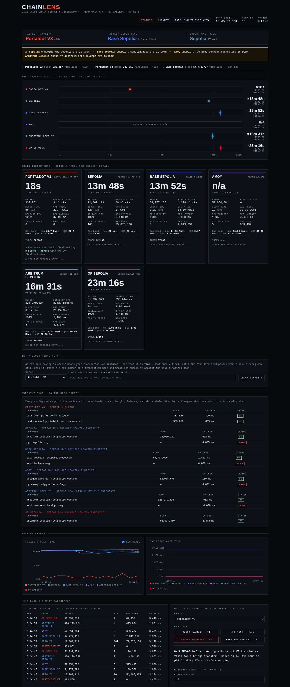

# ChainLens

**Live cross-chain observatory: Portaldot V3 against five other testnets and three mainnets — block time, finality and gas, measured live from public RPCs.**

Built for Portaldot Hacker House 2026, Multi-Chain & Cross-Chain Infra track. Zero dependencies, read-only by design: ChainLens never signs and never sends a transaction — it only reads. (The one exception is the deploy-it-yourself page, where the *visitor's own wallet* signs — ChainLens still holds no keys.)

**Live demo:** https://chainlens-five.vercel.app · **Demo video:** https://youtu.be/i1y2EOLO880 · **Pitch deck:** [docs/PITCH-DECK.md](docs/PITCH-DECK.md)



## Why this exists

Every chain claims to be fast. ChainLens measures instead of claims. It polls nine networks side by side — six testnets and, behind the mainnet toggle, Ethereum, Base and Polygon mainnet — and answers the question users and builders actually care about — **how long until my block is final?** — with live numbers on one screen.

What the live data shows (measured 2026-11-05, re-measured continuously by the dashboard):

- **Portaldot V3 finalizes in about 12 seconds** (finality lag ~2 blocks × 6s blocks).
- Ethereum Sepolia needs **~15 minutes** (lag ~70 blocks × 12s).
- Base Sepolia produces blocks every **0.2s** (Flashblocks) — the fastest block time here — yet its finalized head trails by roughly 4,300–6,500 blocks, about **15–23 minutes** to finality.
- The other L2 testnets land in the same band: Arbitrum Sepolia ~14–19 minutes, OP Sepolia ~21–23 minutes.
- Mainnet tells the same story: Ethereum ~16–18 minutes to finality, Base ~20–23 minutes.
- Sepolia's gas price is the lowest of the testnets.
- Polygon Amoy and Polygon mainnet finalize through Heimdall checkpoints rather than the EVM `finalized` tag; ChainLens reports their finality as **n/a** instead of the fake "0 seconds" the tag would imply.

## Verified two ways — Portaldot's dual stack

Portaldot's finality is **cross-checked two ways on every sample**: the EVM `finalized` tag and the native Substrate finalized head, polled in parallel and shown side by side on the dashboard with an explicit agreement flag (the two stacks must agree within one block, or the sample says so). That cross-check is only possible because of Portaldot V3's dual EVM + Substrate architecture — ChainLens puts that V3 feature to work as a verification method, and it is built for the people who need these numbers most: bridge and multi-chain teams verifying finality assumptions before they deploy.

Every metric is defined precisely in [docs/METHODOLOGY.md](docs/METHODOLOGY.md) — the measurement spec is part of the product, written to be reused and audited.

## What it measures, per chain

- **Block height** and **blocks produced since the monitor started**
- **Block time** — measured between ChainLens's own consecutive samples. Some chains cluster block timestamps, which makes historical-window averages lie (a 20-block window reads Base's clustered timestamps wrong); real-time height/timestamp deltas are honest everywhere. Verified against a 100-block on-chain window on 2026-11-05.
- **Finality lag** — latest head minus finalized head, in blocks and in estimated seconds (lag × that chain's own measured block time)
- **Gas price** — RPC-reported, in wei
- **Block contents** — transactions in the latest block and its gas used
- **Endpoint reliability and latency** — share of successful polls per chain since the monitor started, and each sample's RPC round-trip time; dropped requests are retried with backoff before a poll counts as failed
- **Session statistics** — per-chain min / average / p95 / max finality across the session, so a single lucky sample can't carry the story
- **Finality Index** — a 0–100 score per chain on a published log-scale formula (5s of finality = 100, 30 minutes = 0, from the session average), so chains can be compared at a glance without hiding the raw seconds behind it
- **Gas percentiles** — current gas against the session p50 / p95 band per chain, with spike events when the price breaks 1.5× the p95

Verdicts at the top of the dashboard (fastest finality / fastest block time / lowest gas) are computed from the measured values on every sample — not hardcoded.

## What the dashboard does

- **The Finality Race** — four lanes on a log scale, markers set by each chain's measured time-to-finality; a lane pulses every time its chain finalizes a new block. Fastest blocks and fastest finality stop looking like the same thing.
- **Settlement ticker** — a live wire of real finalization events as ChainLens observes them.
- **Chain instruments with a detail drawer** — click any chain for its session min/avg/p95 finality, reliability, latency, endpoint, chain ID and lag-history sparkline (Portaldot's drawer includes the Substrate cross-check).
- **Session charts** — finality-over-time (with a log-scale toggle) and gas-over-time, drawn from the live sample history.
- **Live block feed** — the latest block observed per poll: height, transactions, gas used, latency.
- **Wait Calculator** — pick a chain and a use case (quick payment ×1, NFT mint ×1.5, bridge transfer ×2, exchange deposit ×3) and ChainLens answers "how long until it's final?" from the session's measured p95 finality times the safety margin — the number a builder actually ships with.
- **Verify it yourself** — one click takes a fresh sample straight from a chain's public RPC and shows the raw values next to the numbers ChainLens computed from them.
- **Embeddable badges and export** — a live SVG finality badge per chain (`/api/badge.svg`) for READMEs and docs, an iframe embed of the whole observatory, and one-click CSV/JSON export of the sample history.
- **Testnet / mainnet toggle** — one click switches the whole observatory between the six testnets and the three mainnets; the view is shareable via URL parameters.
- **"Is my block final yet?" checker** — paste a block number or a transaction hash and get a plain-language answer against the live finalized head (final / not yet, with blocks to go and an ETA / still pending / not found). Confirmed ≠ final, checked live.
- **Endpoint Race** — every configured RPC endpoint per chain raced head-to-head (head height, latency, OK / STALE / DOWN), so when tools disagree about a chain you can see which endpoint is lying. Portaldot's race includes its Substrate head as a second view.
- **Bridge Wait Estimator** — the expected wait for a bridge transfer split into the part ChainLens *measures* (the source chain's session p95 finality) and the part that is a protocol *constant* (e.g. the 7-day canonical challenge for optimistic rollups), labelled and never merged into a fake single number.
- **Confirmations converter** — turns folklore confirmation counts (6 / 12 / 64) into live time per chain at the measured block time, next to copy-paste snippets that read the `finalized` tag instead ("stop counting blocks").
- **Portaldot deep-dive** — EVM finalized lag vs Substrate finalized lag side by side with a dual lag chart, a stream of recent Portaldot finalized blocks, and a two-line GRANDPA explainer.
- **Degradation alerts** — a banner that fires only on measured facts: a chain's reliability dropping, an endpoint going stale or down, or finality running at 2× its session average.
- **Deploy FinalityAnchor yourself** — the compiled contract bytecode served by the dashboard; any visitor can deploy it to Portaldot V3 from their own wallet (see Anchoring below).
- **API explorer** — every public endpoint listed on the page with a live "try it" button.
- **Open dataset tool** — `tools/snapshot.mjs` appends a compact JSON line per poll to a local dataset file; format and reuse terms in [docs/DATASET.md](docs/DATASET.md).

## Run it

```bash
npm start          # dashboard + APIs on http://localhost:4178
npm run once       # one full comparison sample as JSON (takes two polls)
npm test           # offline unit tests for the metric math
npm run smoke      # live smoke test against all watched chains
```

Requires Node.js ≥ 18. No `npm install` needed — there are no dependencies.

APIs: `GET /api/status` (latest comparison + verdicts + session `stats`, now including gas percentiles and the Finality Index), `GET /api/history?n=50` (recent samples), `GET /api/metrics` — the stable, versioned metrics document (`chainlens-metrics/1`) that other tools can consume and cite; see "Adopt this spec" in the methodology — plus `GET /api/badge.svg?chain=portaldot` (live embeddable finality badge), `GET /api/sample?chain=base` (one fresh on-demand sample with the raw RPC values, for verification), `GET /api/history.csv` (the full sample history as CSV), `GET /api/check?chain=portaldot&block=333000` or `&tx=0x…` (is this block/transaction final yet?), `GET /api/endpoints` (the endpoint race: every configured RPC's head + latency), and `GET /api/anchor` (FinalityAnchor bytecode + ABI for the deploy-it-yourself page).

Real sample from `GET /api/metrics`, captured 2026-11-05 and trimmed to one chain — run it yourself and compare:

```json
{
  "spec": "chainlens-metrics/1",
  "generatedAt": "2026-11-05T08:29:32.458Z",
  "chains": {
    "portaldot": {
      "name": "Portaldot V3 Testnet", "chainId": 420420777, "ok": true,
      "height": 332217, "blockTimeSec": 6,
      "finalizedHeight": 332215, "finalityLagBlocks": 2, "finalitySec": 12,
      "finalitySkew": false, "gasWei": 21790, "reliabilityPct": 100
    }
  }
}
```

Every RPC endpoint can be overridden by environment variable (`PORTALDOT_RPC`, `PORTALDOT_SUBSTRATE_RPC`, `SEPOLIA_RPC`, `BASE_RPC`, `AMOY_RPC`, `ARBITRUM_RPC`, `OPTIMISM_RPC`, `ETHEREUM_RPC`, `BASE_MAINNET_RPC`, `POLYGON_MAINNET_RPC`); `PORT` and `POLL_MS` configure the server and poll interval (default 12s).

## How it works

```
src/rpc.js      JSON-RPC client with retry/backoff; terminal errors fail fast
src/chains.js   the nine watched chains with network + endpoint-race config
                (Portaldot carries a Substrate endpoint too)
src/metrics.js  pure metric math — block time, finality lag/seconds, verdict picker,
                session statistics (min/avg/p95, gas percentiles, Finality Index),
                finality status, badge + CSV formatters (unit-tested)
src/poller.js   parallel multi-chain sampler; per-chain reliability, latency and
                block contents; Portaldot finality cross-checked via Substrate
                headers; endpoint race + on-demand finality checker
src/server.js   dashboard + /api/status + /api/history + /api/badge.svg +
                /api/sample + /api/history.csv + /api/endpoints + /api/check +
                /api/anchor
public/         the observatory console (finality race, settlement ticker, chain
                instruments + detail drawer, session charts, block feed, wait
                calculator, finality checker, endpoint race, bridge estimator,
                Portaldot deep-dive, deploy page, API explorer, embed badges)
tools/          snapshot.mjs — appends live samples to an open dataset file
```

On serverless hosting the poller runs per request instead of on a timer, so the public demo takes a fresh live sample on each API call; block time there is computed against the previous request's observation when available.

## Chains watched

| Chain | Chain ID | Network | Role |
|---|---|---|---|
| Portaldot V3 Testnet | 420420777 | testnet | home chain — EVM + Substrate dual read |
| Ethereum Sepolia | 11155111 | testnet | comparison |
| Base Sepolia | 84532 | testnet | comparison |
| Polygon Amoy | 80002 | testnet | comparison (finality n/a — checkpoint-based) |
| Arbitrum Sepolia | 421614 | testnet | comparison |
| OP Sepolia | 11155420 | testnet | comparison |
| Ethereum | 1 | mainnet | comparison |
| Base | 8453 | mainnet | comparison |
| Polygon | 137 | mainnet | comparison (finality n/a — checkpoint-based) |

## Anchoring: FinalityAnchor

The observatory's write path is `FinalityAnchor` (`contracts/FinalityAnchor.sol`, compiled bytecode and ABI alongside it): a small contract that stores ChainLens finality snapshots on Portaldot V3 itself, so anyone can later verify what ChainLens measured and when. Its deployment from our operator account is currently blocked by a Portaldot V3 platform gate — the account was funded with 500 tPOT by the Portaldot team, but the funds sit in the chain's revive fallback account and cannot pay transaction fees until the account is mapped, which this runtime does not let an Ethereum-style key do for itself. The full evidence — signed transaction hashes, the runtime's own call table, the exact errors — is in [docs/ANCHOR-STATUS.md](docs/ANCHOR-STATUS.md). So the dashboard turns the block into a feature: the **Deploy FinalityAnchor Yourself** section serves the exact compiled bytecode (`GET /api/anchor`) and lets any visitor deploy it from their own wallet — their wallet signs, ChainLens never sees a key. No address is claimed until a deployment transaction actually lands.

## Limitation

ChainLens the observatory is read-only by design: it reads nine networks' EVM RPCs (plus Portaldot's Substrate RPC) in real time, holds no keys, and needs no funds to measure. The one thing it cannot yet do from its own account is write its measurements back to Portaldot — that is the FinalityAnchor gate documented above, stated plainly rather than papered over, and routed around honestly by letting visitors deploy the contract themselves.

## License

MIT
